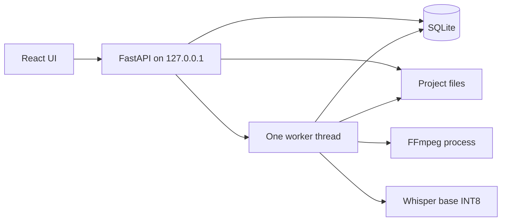
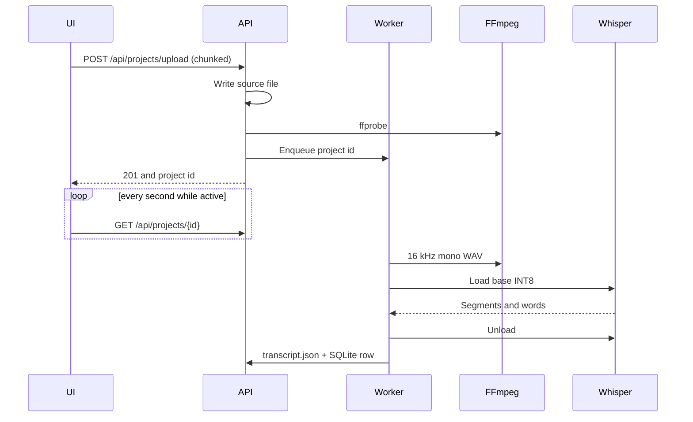

# Clipper architecture

Personal, local application that turns one YouTube video into reviewed Shorts of 20 seconds to 1 minute. A link is downloaded, transcribed, scored against the transcript, and previewed. The full 1080x1920 export waits for approval. Later phases add thumbnails and metadata. They must follow the memory rules in this document.

## 1. Constraints

| Limit | Choice |
| --- | --- |
| Machine | Windows 11, 8 GB RAM, no discrete GPU |
| AI | Ollama and Faster-Whisper on this machine. No OpenAI, Gemini, Claude, or other paid APIs |
| Concurrency | One heavy job at a time. `MAX_CONCURRENT_JOBS` must stay 1 |
| Video in RAM | Never. Uploads are streamed to disk. FFmpeg reads the file in its own process |
| Model residency | Load one model, finish the step, unload it, then load the next |
| Whisper | `base`, device `cpu`, compute `int8`, 4 threads, `num_workers=1` |
| Preview | Later phases analyze a 360 px proxy at 1 fps. Final 1080x1920 encode runs only after approval |

Ollama (`qwen2.5:3b`) is configured now and first used in Phase 2. It is not loaded during transcription. On an 8 GB machine those two models cannot be resident together: Windows, the IDE, and a browser already consume several gigabytes, Whisper base INT8 needs roughly 0.5–1 GB, and a 3B Q4 model needs roughly 2.5–3.5 GB.

Speech models are refused above `small` unless `CLIPPER_ALLOW_LARGE_MODELS=1`. `medium` and `large` Whisper models do not fit this hardware profile. The GPU device is refused for the same reason.

## 2. What this application does not do

The user supplies a local video file, or one YouTube link for a video they have the right to download and edit. A link downloads that single public video to disk with yt-dlp, capped at 1080p, then follows the same audio and transcript path. Playlists, channel pages, live streams, and other websites are refused. The downloader does not use browser cookies or a signed-in session. The file is written by a child process and is not loaded into Python.

Metadata and thumbnails describe what was spoken. They must not invent events, quotes, or a promise that a title will perform well.

## 3. Phase plan

| Phase | Outcome | Status |
| --- | --- | --- |
| 1 | Architecture, local upload or one YouTube link, metadata, audio extract, Whisper transcript with sentence and word times, review UI | This build |
| 2 | Ollama reads the saved transcript and returns scored clip candidates. Timestamps are checked against the transcript | This build |
| 3 | Approved candidates become 1080x1920 H.264/AAC shorts with burned-in word-level subtitles. Low-res preview first | This build |
| 4 | Pillow thumbnails, titles, description, hashtags, CTA. Optional local image model stays off | This build |
| 5 | Full dashboard totals, export history, and the remaining clip tables | Not started |

Phase 1 already persists projects, source files, transcripts, and jobs in SQLite. That storage is required to run and resume the pipeline. Clip, thumbnail, and metadata tables arrive with the phase that produces them (`schema_version` is 1).

## 4. Runtime



- API and UI are separate processes. The API binds to `127.0.0.1` and runs one Uvicorn worker.
- The worker is a daemon thread inside that process, fed by a condition variable. It is not a second process and it is not a process pool.
- FFmpeg and ffprobe are subprocesses. Their memory dies with the process.
- Faster-Whisper is imported only inside the transcription call, then unloaded with `gc.collect()`.
- Restarting the API marks any `queued` or running job failed with "Interrupted by an application restart." The user can start it again. A reload flag is not used for real jobs, because a reload kills the worker mid-model.

### Memory order for a later full run

1. Stream upload and ffprobe (headers only).
2. Extract 16 kHz mono PCM WAV. Delete is deferred; the WAV is the Whisper input and is much smaller than the video.
3. Load Whisper, transcribe, write JSON, unload Whisper.
4. Phase 2 only after that unload: one Ollama JSON call.
5. Phase 3: face and crop decisions from a 360 px, 1 fps proxy. Final encode is a subprocess after the user approves.
6. Phase 4: one frame and Pillow. No vision LLM by default.

## 5. Repository layout

```
Clipper/
  architecture.md
  README.md
  backend/
    app/
      main.py                 API, lifespan, error mapping
      config.py               Hardware-safe defaults
      db.py                   SQLite
      schemas.py              Pydantic responses
      services/
        video_service.py      ffprobe and audio extract
        transcription_service.py
        storage_service.py    Paths and atomic JSON
        pipeline.py           Phase 1 stages
        job_manager.py        Queue of one
    tests/
  frontend/                   React, TypeScript, Vite, Tailwind
  data/                       SQLite, uploads, audio, transcripts, model cache
  output/                     Approved exports from Phase 3 onward
  tools/ffmpeg/               Portable ffmpeg.exe and ffprobe.exe
```

Modules added in later phases, not present yet: `ollama_service.py`, `highlight_service.py`, `clip_validation_service.py`, `rendering_service.py`, `caption_service.py`, `thumbnail_service.py`, `metadata_service.py`.

Approved exports will use:

```
output/<project_id>/clip_001/short.mp4
output/<project_id>/clip_001/thumbnail.jpg
output/<project_id>/clip_001/metadata.json
output/<project_id>/clip_001/subtitles.srt
```

Working files stay in `data/` so a failed experiment is not mixed with an approved export:

```
data/clipper.db
data/logs/app.log
data/models/whisper/          Faster-Whisper base weights
data/models/hf/               VAD assets on first run
data/projects/<uuid>/source.mp4
data/projects/<uuid>/work/audio.wav
data/projects/<uuid>/work/transcript.json
```

`CLIPPER_MODEL_CACHE` can move the weights. Tests point it at the repo cache so a temporary database does not download them again.

## 6. Phase 1 pipeline



Stages and progress:

| Progress | Status | Work |
| --- | --- | --- |
| 0 | queued | Waiting. A job id is only a few bytes |
| 10 | extracting_audio | FFmpeg `-vn -ac 1 -ar 16000 -c:a pcm_s16le` |
| 32–95 | transcribing | Model load, then segment end / duration |
| 96 | transcribing | Atomic write of transcript JSON |
| 100 | ready | Model already released |

Cancellation is checked before extraction, between FFmpeg polls (the extract process is terminated), and between Whisper segments. It does not slice an in-flight Whisper window. Queued work that has not started is removed immediately.

The queue holds the running job plus up to `MAX_QUEUED_JOBS` (default 4) ids. A further request returns HTTP 409. Nothing in the queue loads a model.

Uploads are 1 MB chunks. The default ceiling is 4 GB (`MAX_UPLOAD_BYTES`). A `.txt` renamed to `.mp4` fails ffprobe, the partial file is removed, and the project is stored as `failed` so the history shows the attempt.

Accepted extensions: `.mp4`, `.mov`, `.mkv`, `.webm`, `.avi`, `.m4v`.

### Transcript JSON

```json
{
  "language": "en",
  "language_probability": 0.98,
  "model": "base",
  "duration": 12.4,
  "text": "Hello world.",
  "segments": [
    {
      "start": 0.0,
      "end": 1.2,
      "text": "Hello world.",
      "words": [
        {"word": " Hello", "start": 0.1, "end": 0.4, "probability": 0.93}
      ]
    }
  ],
  "sentences": [
    {
      "id": 0,
      "start": 0.0,
      "end": 1.2,
      "text": "Hello world.",
      "words": [
        {"word": " Hello", "start": 0.1, "end": 0.4, "probability": 0.93}
      ]
    }
  ],
  "warnings": []
}
```

Sentences are groups of Whisper words, split when a word ends in `.`, `?`, `!`, or `…`. The joiner does not add, delete, or rewrite tokens. A segment with no word times is kept as one sentence and an empty word list.

Hard failures (the job is `failed`, the JSON is not saved):

- A sentence or word ends before it starts.
- Word start times inside a sentence go backwards.

Warnings (the job still completes):

- No speech detected.
- A sentence overlaps the previous one by more than 0.2 s.
- A sentence ends more than 0.75 s after the probed media duration.

Whisper settings that keep CPU memory down: `beam_size=1`, `best_of=1`, `temperature=0.0`, `condition_on_previous_text=false`, `vad_filter=true`, `num_workers=1`. VAD can be turned off with `WHISPER_VAD_FILTER=false` if the Silero asset fails to load.

## 7. Phase 2 contract

One Ollama chat against `OLLAMA_HOST`, after Whisper is unloaded. `OLLAMA_MODEL` is only the preferred name. If that model is not installed, Clipper uses another model from the local Ollama library, and Settings can switch to any installed model. The prompt receives the sentence list only, not the video. The response is parsed with Pydantic. Invalid JSON, timeout, a missing model, and an out-of-memory error from Ollama become a failed job with the model left unused.

The model may only quote transcript text. Candidates that skip a sentence in a way that changes the claim are rejected by `clip_validation_service` before they are shown.

```json
{
  "clips": [
    {
      "start": 12.40,
      "end": 29.10,
      "duration": 16.70,
      "transcript": "exact joined sentences",
      "opening_hook": "short spoken-style hook drawn from the quote",
      "category": "practical tip",
      "score": 78,
      "score_breakdown": {
        "opening_hook": 20,
        "interesting_content": 16,
        "emotional_impact": 10,
        "context": 12,
        "complete_thought": 10,
        "shareability": 7,
        "av_quality": 3
      },
      "reason": "why this span is a complete thought",
      "suggested_title": "title based on the quote"
    }
  ]
}
```

Score weights: hook 25, interesting content 20, emotion and curiosity 15, context 15, complete thought 10, shareability 10, audio/visual quality 5.

Validator rules for Phase 2:

- 5–10 clips when the transcript has enough complete thoughts. Fewer is valid when it does not.
- Duration is 20–60 seconds. If a thought is shorter, the candidate is dropped rather than padded with unrelated sentences. A longer span is shrunk into that window.
- `start` and `end` snap to sentence boundaries that exist in `transcript.json`.
- Spans should not overlap. Exact duplicate quotes are removed.
- `transcript` must equal the join of the sentences in range.
- `av_quality` stays at most 3 until Phase 3 measures a real frame. The model must not invent a visual score.

## 8. Phase 3 render plan (this build)

- Proxy: scale the source to width 360, sample 1 fps, run a small CPU face detector (OpenCV Haar or an equivalent), store one crop window per second. Do not decode the full-resolution film into a Python list.
- Default output, only after approval: 1080x1920, H.264, AAC, 20–60 seconds, original audio sample rate preserved as far as AAC allows, loudness left unchanged.
- Landscape sources use the stored face window. Portrait sources are scaled and padded. A manual crop offset is stored on the clip and wins over the detector.
- Subtitles are ASS or SRT consumed by FFmpeg, word-timed from the transcript. Keyword emphasis is a style on words already in the transcript. Caption y-position stays out of the stored face box.
- Zoom is optional and off by default (extra filter graph, more CPU).

## 9. Phase 4 metadata plan (this build)

Ollama returns three titles, one description, 3–5 hashtags, a thumbnail headline, a CTA, a category, and keywords. The prompt includes the clip transcript only.

Thumbnails:

- Mode 1, the default: pick a frame near the middle of the clip from the proxy timeline, draw the headline with Pillow, save JPEG.
- Mode 2: a local image model, disabled unless a setting names an already running local server. The MVP does not require it.

## 10. API (Phase 1)

| Method | Path | Purpose |
| --- | --- | --- |
| GET | `/api/health` | FFmpeg, Whisper profile, queue depth. Always HTTP 200 if the process is up |
| POST | `/api/projects/upload` | Multipart `file` and optional `title` |
| GET | `/api/projects` | Newest projects, no transcript body |
| GET | `/api/projects/{id}` | Metadata, status, progress |
| GET | `/api/projects/{id}/transcript` | Sentences and words |
| GET | `/api/projects/{id}/media` | Range-capable file response |
| POST | `/api/projects/{id}/process` | Run again after failure, cancel, or a busy upload |
| POST | `/api/projects/{id}/highlights` | Queue Ollama scoring for a saved transcript |
| GET | `/api/projects/{id}/highlights` | Validated clip candidates |
| POST | `/api/projects/{id}/cancel` | Cancel queued or running work |
| GET | `/api/jobs` | Processing history |
| GET | `/api/jobs/{id}` | One job |

Domain errors: 400 validation, 404 unknown id, 409 busy or not cancellable, 413 over the upload limit, 503 FFmpeg missing. Unhandled exceptions are logged to `data/logs/app.log` and the client sees a short message, not a traceback.

## 11. Database (schema version 5)

- `projects` — title, status, progress, error, current job id
- `source_videos` — path, size, duration, dimensions, codecs, audio flag
- `transcripts` — language, model, counts, JSON path, 240-character preview
- `jobs` — kind (`transcribe` or `highlight`), stage, progress, timestamps, error
- `candidate_clips` — snapped times, spoken transcript, score breakdown, title
- `clip_renders` — preview and export paths, crop mode, manual offset, approval
- `clip_metadata` — titles, description, hashtags, headline, call to action, keywords, thumbnail paths
- `schema_version`

Statuses for a project: `uploaded`, `queued`, `downloading`, `extracting_audio`, `transcribing`, `analyzing`, `rendering`, `ready`, `failed`, `cancelled`. A failed highlight or render returns the project to `ready` and keeps the transcript.

Job statuses: `queued`, `running`, `completed`, `failed`, `cancelled`.

SQLite uses WAL, foreign keys, a 5 second busy timeout, and one `RLock` shared with the worker so the request thread and the worker never use the connection together. The full transcript is a file. The database stores the path and a preview so list screens stay small.

## 12. Frontend

Dark UI, system Segoe UI, no remote fonts. Vite proxies `/api` to `127.0.0.1:8000`.

| Route | What the page does |
| --- | --- |
| `/` | Counts and recent projects from the API |
| `/new` | Local file picker and upload progress |
| `/analysis` | Picker |
| `/projects/:id` | Metadata, source player (`preload=metadata`), live progress, transcript |
| `/history` | Jobs |
| `/settings` | Effective Whisper, FFmpeg, and Ollama configuration |
| `/highlights` | Scored clip candidates |
| `/preview` | Low-resolution vertical preview, manual crop, approval |
| `/shorts` | 1080×1920 export after approval |
| `/thumbnails` | One-frame thumbnail with a spoken headline |
| `/metadata` | Editable titles, description, hashtags, and call to action |

The browser polls once a second while a project is queued or running, then stops.

## 13. Configuration

See `.env.example`. Defaults live in `backend/app/config.py`.

| Variable | Default |
| --- | --- |
| `DATA_DIR` | `<repo>/data` |
| `WHISPER_MODEL` | `base` |
| `WHISPER_DEVICE` | `cpu` |
| `WHISPER_COMPUTE_TYPE` | `int8` |
| `WHISPER_THREADS` | `4`, clamped to the CPU count |
| `WHISPER_VAD_FILTER` | `true` |
| `MAX_CONCURRENT_JOBS` | `1` |
| `MAX_QUEUED_JOBS` | `4` |
| `MAX_UPLOAD_BYTES` | 4 GB |
| `OLLAMA_HOST` | `http://localhost:11434` |
| `OLLAMA_MODEL` | `qwen2.5:3b` |
| `FFMPEG_PATH` / `FFPROBE_PATH` | Bundled `tools/ffmpeg`, then `PATH` |

FFmpeg is resolved at call time. Health reports the path and version without failing the process, so the UI can explain a missing binary.

## 14. Logging, failure, and tests

`clipper.*` loggers write to the console and to a 2 MB rotating file under `data/logs`. Transcript text is not logged.

Phase 1 tests cover metadata, 16 kHz extraction, missing audio, sentence grouping, timestamp rejection, model unload, the hardware guard, upload through a saved transcript (Whisper mocked), queueing, cancel, and one end-to-end transcription of a local synthetic speech sample. Render, subtitle burn-in, Ollama JSON, and metadata tests belong to the phases that add that code.

## 15. Decisions

1. **Stdlib `sqlite3` instead of an ORM.** One less package, explicit SQL, one lock.
2. **No yt-dlp.** Rights and YouTube's terms stay with the file the user uploads.
3. **Whisper before Ollama, never overlapping.** This is the difference between fitting in 8 GB and paging.
4. **INT8 `base` with beam size 1.** Accuracy is lower than a large model. That is the acceptable trade for this machine. `small` is the largest supported step up.
5. **Working files in `data/`, approved files in `output/`.** Phase 1 does not pretend a transcript is a finished Short.
6. **Portable FFmpeg under `tools/ffmpeg`.** The app does not require a system install or a new terminal PATH.
7. **Python 3.11+.** This workstation has 3.13. The code stays on 3.11 syntax.
